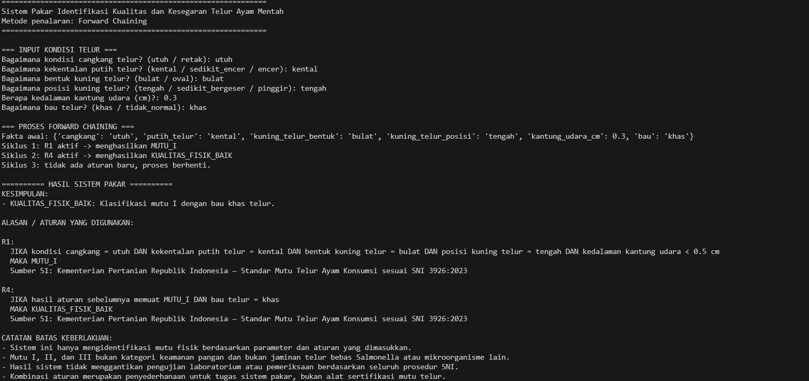
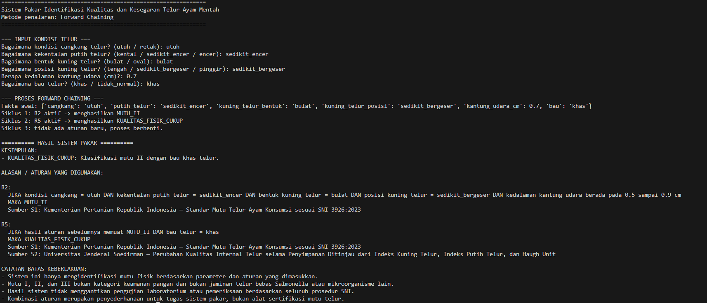
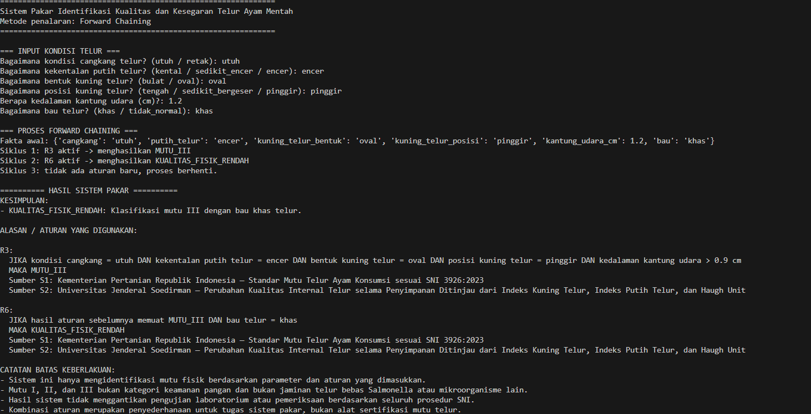
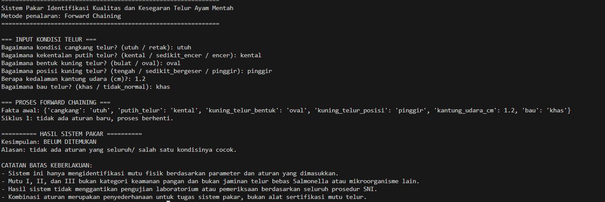
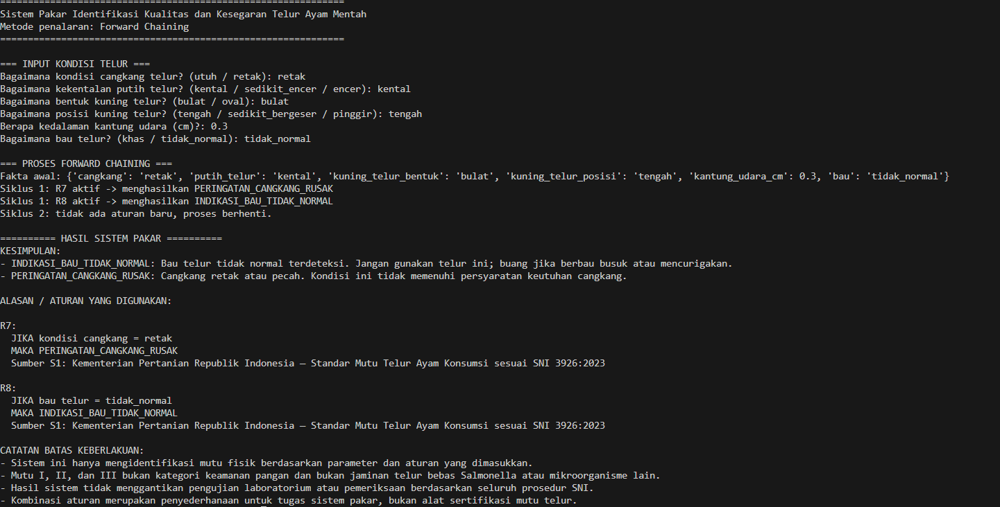

# Sistem Pakar Identifikasi Kualitas dan Kesegaran Telur Ayam Mentah

## Identitas

- **Nama:** Melani Putri Zahari
- **NIM:** F1D02410073
- **Mata Kuliah:** Kecerdasan Buatan
- **Program Studi:** Teknik Informatika

## 1. Deskripsi

Program ini dibuat untuk membantu mengidentifikasi mutu fisik telur ayam mentah berdasarkan kondisi cangkang, kekentalan putih telur, bentuk dan posisi kuning telur, kedalaman kantung udara, serta bau telur.

Metode yang digunakan adalah **Forward Chaining**. Program memulai penalaran dari fakta yang dimasukkan pengguna, kemudian mencocokkannya dengan aturan IF–THEN. Jika ada aturan yang sesuai, hasilnya disimpan dan dapat digunakan oleh aturan berikutnya. Proses diulang sampai tidak ada aturan baru yang bisa dijalankan.

## 2. Sumber Pengetahuan

**S1 — Kementerian Pertanian Republik Indonesia**

Nuraini. (2024, 28 Juni). *Standar Mutu Telur Ayam Konsumsi sesuai SNI 3926:2023*. Balai Penerapan Standar Instrumen Pertanian Kepulauan Bangka Belitung, Kementerian Pertanian Republik Indonesia.

- [Buka artikel](https://babel.brmp.pertanian.go.id/berita/standar-mutu-telur-ayam-konsumsi-sesuai-sni-3926-2023)
- Tanggal akses: 14 November 2026.

Sumber ini menjadi acuan awal untuk parameter mutu fisik telur, seperti kondisi kerabang, kantung udara, putih telur, kuning telur, dan bau.

**S2 — Artikel ilmiah/prosiding**

Baskoro, T. A., Al Amin, M. F., Wijaksono, M. A., & Fadhlurrohman, I. (2026). *Perubahan Kualitas Internal Telur selama Penyimpanan Ditinjau dari Indeks Kuning Telur, Indeks Putih Telur, dan Haugh Unit*. Prosiding Seminar Nasional Pembangunan dan Pendidikan Vokasi Pertanian, 7(1), 1042–1049.

- Afiliasi penulis: Universitas Jenderal Soedirman.
- DOI: [https://doi.org/10.47687/snppvp.v7i1.2266](https://doi.org/10.47687/snppvp.v7i1.2266)
- [Buka artikel](https://jurnal.polbangtanmanokwari.ac.id/index.php/prosiding/article/view/2266)
- Tanggal akses: 14 November 2026.

Artikel ini digunakan sebagai tambahan pengetahuan tentang perubahan kualitas bagian dalam telur selama penyimpanan, terutama indeks kuning telur, indeks putih telur, dan Haugh Unit.

Aturan dalam program merupakan penyederhanaan untuk tugas sistem pakar. Aturan tersebut tidak mewakili seluruh parameter dan prosedur pemeriksaan dalam SNI 3926:2023.

## 3. Fakta yang Ditanyakan kepada Pengguna

Program meminta enam informasi berikut:

1. Kondisi cangkang: utuh atau retak.
2. Kekentalan putih telur: kental, sedikit encer, atau encer.
3. Bentuk kuning telur: bulat atau oval.
4. Posisi kuning telur: tengah, sedikit bergeser, atau pinggir.
5. Kedalaman kantung udara dalam cm.
6. Bau telur: khas atau tidak normal.

## 4. Aturan IF–THEN

| Aturan | IF (kondisi) | THEN (hasil) | Sumber |
|---|---|---|---|
| R1 | Cangkang utuh AND putih telur kental AND kuning telur bulat di tengah AND kantung udara < 0,5 cm | MUTU_I | S1 |
| R2 | Cangkang utuh AND putih telur sedikit encer AND kuning telur bulat sedikit bergeser AND kantung udara 0,5–0,9 cm | MUTU_II | S1 |
| R3 | Cangkang utuh AND putih telur encer AND kuning telur oval di pinggir AND kantung udara > 0,9 cm | MUTU_III | S1 |
| R4 | Hasil aturan sebelumnya memuat MUTU_I AND bau khas | KUALITAS_FISIK_BAIK | S1 |
| R5 | Hasil aturan sebelumnya memuat MUTU_II AND bau khas | KUALITAS_FISIK_CUKUP | S1 |
| R6 | Hasil aturan sebelumnya memuat MUTU_III AND bau khas | KUALITAS_FISIK_RENDAH | S1 |
| R7 | Cangkang retak | PERINGATAN_CANGKANG_RUSAK | S1 |
| R8 | Bau tidak normal | INDIKASI_BAU_TIDAK_NORMAL | S1 |

R4, R5, dan R6 memakai hasil dari aturan sebelumnya. Contohnya, R1 menghasilkan `MUTU_I`. Hasil tersebut kemudian dipakai oleh R4 bersama fakta bahwa bau telur khas untuk menghasilkan `KUALITAS_FISIK_BAIK`. Bagian ini menunjukkan proses berantai pada Forward Chaining.

File `aturan_telur.json` memiliki pilihan mode `dan` dan `atau`. Mode `dan` berarti semua kondisi harus terpenuhi, sedangkan mode `atau` berarti cukup salah satu kondisi terpenuhi. Mesin program mendukung kedua mode tersebut. Aturan yang digunakan saat ini semuanya memakai mode `dan`.

## 5. Cara Kerja dan Alasan Memilih Forward Chaining

Forward Chaining dipilih karena pemeriksaan dimulai dari kondisi telur yang dimasukkan pengguna, bukan dari kesimpulan yang dipilih terlebih dahulu. Cara ini sesuai dengan alur program: pengguna menjawab pertanyaan, program memeriksa aturan, lalu menghasilkan kesimpulan jika syaratnya terpenuhi.

Urutan proses program:

1. Membaca fakta dari jawaban pengguna.
2. Membaca aturan dari `aturan_telur.json`.
3. Memeriksa kondisi setiap aturan.
4. Menyimpan hasil aturan yang cocok ke memori.
5. Menggunakan hasil aturan sebelumnya untuk memeriksa aturan berikutnya.
6. Mengulangi pemeriksaan sampai tidak ada aturan baru.
7. Menampilkan kesimpulan, alasan, aturan yang digunakan, sumber, dan catatan batas keberlakuan.

Mesin Forward Chaining dibuat sendiri di dalam `main.py`.

## 6. Struktur Folder

```text
Sistem_Pakar_Telur/
├── main.py
├── aturan_telur.json
├── README.md
└── screenshot/
    ├── pengujian_1_mutu_baik.png
    ├── pengujian_2_mutu_cukup.png
    ├── pengujian_3_mutu_rendah.png
    ├── pengujian_4_tanpa_kesimpulan.png
    └── pengujian_5_peringatan.png
```

## 7. Cara Menjalankan Program

**Kebutuhan:** Python 3. Program diuji menggunakan Python 3.14.4.

1. Pastikan `main.py` dan `aturan_telur.json` berada dalam folder yang sama.
2. Buka terminal pada folder proyek.
3. Jalankan perintah berikut:

```bash
python main.py
```

4. Jawab pertanyaan yang muncul di terminal sesuai kondisi telur yang diperiksa.

Program menggunakan modul bawaan Python, yaitu `json` dan `pathlib`, jadi tidak perlu memasang library tambahan.

## 8. Kasus Uji dan Bukti Pengujian

Program diuji dengan lima kondisi. Empat kasus pertama memeriksa hasil klasifikasi atau kondisi ketika aturan tidak cocok. Kasus kelima memeriksa apakah dua aturan peringatan dapat aktif bersamaan.

| No. | Data masukan | Hasil yang diharapkan |
|---|---|---|
| 1 | Utuh; putih kental; kuning bulat di tengah; kantung udara 0,3 cm; bau khas | KUALITAS_FISIK_BAIK |
| 2 | Utuh; putih sedikit encer; kuning bulat sedikit bergeser; kantung udara 0,7 cm; bau khas | KUALITAS_FISIK_CUKUP |
| 3 | Utuh; putih encer; kuning oval di pinggir; kantung udara 1,2 cm; bau khas | KUALITAS_FISIK_RENDAH |
| 4 | Utuh; putih kental; kuning oval di pinggir; kantung udara 1,2 cm; bau khas | Belum ditemukan kesimpulan |
| 5 | Retak; putih kental; kuning bulat di tengah; kantung udara 0,3 cm; bau tidak normal | PERINGATAN_CANGKANG_RUSAK dan INDIKASI_BAU_TIDAK_NORMAL |

### Screenshot Pengujian

**Pengujian 1 — Kualitas fisik baik**



**Pengujian 2 — Kualitas fisik cukup**



**Pengujian 3 — Kualitas fisik rendah**



**Pengujian 4 — Tidak ditemukan kesimpulan**



**Pengujian 5 — Cangkang retak dan bau tidak normal**



## 9. Batas Keberlakuan

Sistem ini menggunakan informasi dari sumber pemerintah dan artikel ilmiah yang dicantumkan pada bagian sumber pengetahuan. Sistem hanya membantu mengidentifikasi mutu fisik telur ayam mentah berdasarkan enam parameter yang dimasukkan pengguna. Hasilnya merupakan saran berdasarkan aturan yang tersedia, bukan keputusan akhir, sertifikat mutu, atau jaminan keamanan pangan. Program tidak melakukan pemeriksaan laboratorium dan tidak dapat memastikan telur bebas Salmonella atau mikroorganisme lainnya. Klasifikasi yang dihasilkan juga tidak menggantikan pemeriksaan berdasarkan seluruh persyaratan dan prosedur SNI 3926:2023.

## 10. Penggunaan AI

AI digunakan sebagai alat bantu selama pengerjaan, terutama untuk memahami konsep Forward Chaining, mendiskusikan susunan aturan, memeriksa kode, dan merapikan dokumentasi. Program tetap dijalankan dan diuji menggunakan beberapa contoh masukan. Saya bertanggung jawab untuk memahami cara kerja program, aturan yang digunakan, dan hasil pengujiannya.

## 11. Pengembangan

Untuk pengembangan berikutnya, program dapat ditambah dengan parameter pemeriksaan lain dan aturan yang lebih lengkap berdasarkan dokumen standar. Program juga dapat dibuat dengan tampilan antarmuka agar lebih mudah digunakan.